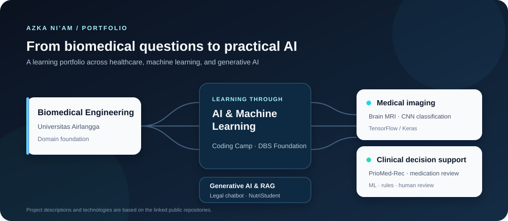

# Azka Ni’am

### Biomedical Engineering Student · AI Engineering & Applied Machine Learning

*Building practical AI solutions at the intersection of healthcare, data, and human needs.*

[LinkedIn](https://www.linkedin.com/in/azka-ni-am-b57479367) · [GitHub](https://github.com/azkastudying1-hub)

  

---

## About

Halo, saya **Azka Ni’am**, mahasiswa S1 **Teknik Biomedis di Universitas Airlangga** yang sedang mengembangkan kompetensi **AI Engineering** melalui **Coding Camp powered by DBS Foundation**.

Saya tertarik menerapkan machine learning dan generative AI untuk menyelesaikan masalah nyata—terutama di bidang kesehatan. Portofolio saya mencakup prototipe clinical decision support, klasifikasi citra medis, serta aplikasi chatbot dan retrieval-augmented generation (RAG). Saya senang belajar melalui proyek, berkolaborasi, dan mengikuti program pengembangan teknologi.

> **Fokus:** AI/ML · Generative AI & RAG · Biomedical AI · Python

## Selected Projects

| Proyek | Area | Ringkasan | Teknologi / metode |
|---|---|---|---|
| [**PrioMed-Rec**](https://github.com/azkastudying1-hub/PrioMed-Rec) | Clinical decision support | Prototipe untuk membantu farmasis memprioritaskan telaah rekonsiliasi obat saat admisi. Mencakup ranking risiko, pemeriksaan diskrepansi, dan draf SBAR untuk ditinjau profesional. | Python · FastAPI · React/Vite · XGBoost · SHAP · LLM |
| [**Klasifikasi Citra MRI Tumor Otak**](https://github.com/azkastudying1-hub/Klasifikasi-Citra-MRI-Tumor-Otak) | Biomedical computer vision | Proyek klasifikasi citra MRI otak menggunakan CNN; repository menyediakan model SavedModel, TensorFlow Lite, dan TensorFlow.js. | Python · TensorFlow/Keras · CNN |
| [**Chatbot Legal berbasis RAG**](https://github.com/azkastudying1-hub/Proyek_Akhir_Fine-tuned_Chatbot_Tim_Legal_berbasis_RAG) | Generative AI | Proyek akhir tim untuk chatbot legal yang berfokus pada fine-tuning dan RAG. | Fine-tuning · RAG |
| [**NutriStudent**](https://github.com/azkastudying1-hub/NutriStudent---Bot-Gizi-Mahasiswa) | AI & nutrition | Chatbot gizi mahasiswa dengan RAG berbasis referensi, kalkulator gizi, dan rekomendasi menu hemat. | Python · Streamlit · LangChain · Gemini · FAISS |
| [**CentSaver-AI**](https://github.com/azkastudying1-hub/CentSaver-AI) | Learning project | Proyek Coding Camp DBS Foundation. Repository ini adalah fork; silakan lihat repository sumber untuk konteks kepemilikan proyek. | Coding Camp · AI |

<strong>Jelajahi portofolio berdasarkan area</strong>

| Area | Proyek | Repository |
|---|---|---|
| AI untuk layanan kesehatan | PrioMed-Rec — prioritisasi telaah rekonsiliasi obat | [Buka repository](https://github.com/azkastudying1-hub/PrioMed-Rec) |
| Biomedical computer vision | Klasifikasi citra MRI tumor otak dengan CNN | [Buka repository](https://github.com/azkastudying1-hub/Klasifikasi-Citra-MRI-Tumor-Otak) |
| Generative AI | Chatbot legal berbasis RAG dan fine-tuning | [Buka repository](https://github.com/azkastudying1-hub/Proyek_Akhir_Fine-tuned_Chatbot_Tim_Legal_berbasis_RAG) |
| AI untuk kesejahteraan mahasiswa | NutriStudent — chatbot gizi berbasis RAG | [Buka repository](https://github.com/azkastudying1-hub/NutriStudent---Bot-Gizi-Mahasiswa) |
| Program pembelajaran AI | CentSaver-AI — fork proyek Coding Camp DBS Foundation | [Buka repository](https://github.com/azkastudying1-hub/CentSaver-AI) |

## Skills in Practice

| Bidang | Pengalaman yang tercermin dalam proyek |
|---|---|
| Programming & data | Python, Jupyter Notebook |
| Machine learning | TensorFlow/Keras, CNN, klasifikasi citra, evaluasi model |
| Generative AI | RAG, LangChain, embeddings, vector search, integrasi LLM |
| Aplikasi | Streamlit, FastAPI, React/Vite |
| Domain | Teknik biomedis, medical imaging, clinical decision support |

*Daftar ini merangkum tools dan metode yang tercantum dalam repository; bukan penilaian tingkat kemahiran.*

## Learning Journey

Saya terbuka untuk **kompetisi, bootcamp, pelatihan, proyek kolaboratif, dan kesempatan belajar** di bidang AI, machine learning, serta teknologi kesehatan. Saya menghargai proses yang berorientasi pada dampak, dokumentasi yang baik, evaluasi yang bertanggung jawab, dan kerja sama lintas disiplin.

## GitHub Activity

Temukan proyek, kode, dan dokumentasi terbaru di [profil GitHub saya](https://github.com/azkastudying1-hub). Grafik portofolio di bagian atas dibuat sebagai aset SVG di repository ini agar tampil tanpa bergantung pada layanan statistik pihak ketiga.

## Let’s Connect

Saya senang bertukar ide, belajar bersama, dan berkolaborasi dalam proyek teknologi yang bermanfaat.

- **LinkedIn:** [azka-ni-am](https://www.linkedin.com/in/azka-ni-am-b57479367)
- **GitHub:** [@azkastudying1-hub](https://github.com/azkastudying1-hub)

---

*Terus belajar, membangun, dan menghadirkan teknologi yang lebih bermakna.*

