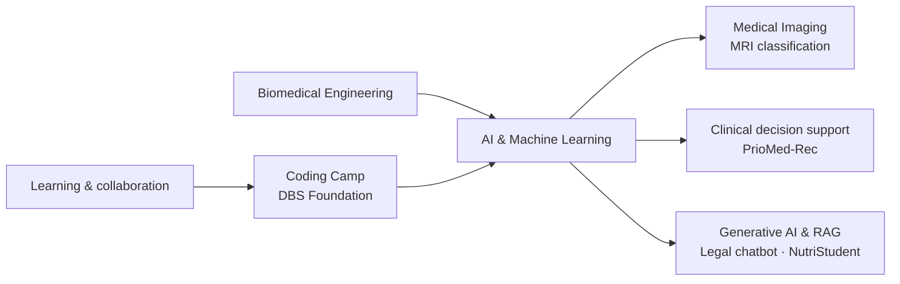

# Azka Ni’am

### Biomedical Engineering Student · AI Engineering & Applied Machine Learning

*Building practical AI solutions at the intersection of healthcare, data, and human needs.*

[LinkedIn](https://www.linkedin.com/in/azka-ni-am-b57479367) · [GitHub](https://github.com/azkastudying1-hub)

---

## About

Halo, saya **Azka Ni’am**, mahasiswa S1 **Teknik Biomedis di Universitas Airlangga** yang sedang mengembangkan kompetensi di bidang **AI Engineering** melalui **Coding Camp powered by DBS Foundation**.

Saya tertarik menerapkan machine learning dan generative AI untuk menyelesaikan masalah nyata—terutama di bidang kesehatan. Portofolio saya mencakup prototipe clinical decision support, klasifikasi citra medis, serta aplikasi berbasis chatbot dan retrieval-augmented generation (RAG). Saya senang belajar melalui proyek, berkolaborasi, dan mengikuti program pengembangan teknologi.

> **Fokus saat ini:** AI/ML · Generative AI & RAG · Biomedical AI · Python

## Selected Projects

| Proyek | Ringkasan | Fokus / teknologi |
|---|---|---|
| [**PrioMed-Rec**](https://github.com/azkastudying1-hub/PrioMed-Rec) | Prototipe clinical decision support untuk membantu farmasis memprioritaskan telaah rekonsiliasi obat saat admisi. Menyertakan ranking risiko, pemeriksaan diskrepansi, dan draf laporan SBAR untuk ditinjau tenaga profesional. | Python · FastAPI · React/Vite · XGBoost · SHAP · LLM |
| [**Klasifikasi Citra MRI Tumor Otak**](https://github.com/azkastudying1-hub/Klasifikasi-Citra-MRI-Tumor-Otak) | Proyek klasifikasi citra MRI otak menggunakan CNN. Repository menyediakan model dalam format SavedModel, TensorFlow Lite, dan TensorFlow.js. | Python · TensorFlow/Keras · CNN · Computer Vision |
| [**Chatbot Legal berbasis RAG**](https://github.com/azkastudying1-hub/Proyek_Akhir_Fine-tuned_Chatbot_Tim_Legal_berbasis_RAG) | Proyek akhir chatbot tim legal yang berfokus pada fine-tuning dan pendekatan RAG. | Generative AI · Fine-tuning · RAG |
| [**NutriStudent**](https://github.com/azkastudying1-hub/NutriStudent---Bot-Gizi-Mahasiswa) | Chatbot gizi untuk mahasiswa dengan RAG berbasis referensi, kalkulator gizi, dan rekomendasi menu hemat. | Python · Streamlit · LangChain · Gemini · FAISS |
| [**CentSaver-AI**](https://github.com/azkastudying1-hub/CentSaver-AI) | Proyek AI dari Coding Camp DBS Foundation. Repository ini merupakan fork dari proyek sumber; lihat dokumentasi untuk konteks dan kontribusi. | AI · Coding Camp DBS Foundation |

<strong>Jelajahi ringkasan proyek dan tautannya</strong>

| Area | Proyek | Repository |
|---|---|---|
| AI untuk layanan kesehatan | PrioMed-Rec — prioritisasi telaah rekonsiliasi obat | [Buka repository](https://github.com/azkastudying1-hub/PrioMed-Rec) |
| Biomedical computer vision | Klasifikasi citra MRI tumor otak dengan CNN | [Buka repository](https://github.com/azkastudying1-hub/Klasifikasi-Citra-MRI-Tumor-Otak) |
| Generative AI | Chatbot legal berbasis RAG dan fine-tuning | [Buka repository](https://github.com/azkastudying1-hub/Proyek_Akhir_Fine-tuned_Chatbot_Tim_Legal_berbasis_RAG) |
| AI untuk kesejahteraan mahasiswa | NutriStudent — chatbot gizi berbasis RAG | [Buka repository](https://github.com/azkastudying1-hub/NutriStudent---Bot-Gizi-Mahasiswa) |
| Program pembelajaran AI | CentSaver-AI — fork proyek Coding Camp DBS Foundation | [Buka repository](https://github.com/azkastudying1-hub/CentSaver-AI) |

## Portfolio at a Glance

## Skills in Practice

- **Programming & data:** Python, Jupyter Notebook
- **Machine learning:** TensorFlow/Keras, CNN, image classification, model evaluation
- **Generative AI:** RAG, LangChain, embeddings, vector search, LLM integrations
- **Application development:** Streamlit, FastAPI, React/Vite
- **Domain interests:** Biomedical engineering, medical imaging, clinical decision support

*Skills above reflect tools and methods documented in the linked projects; proficiency levels are not self-rated here.*

## Learning Journey

Saya terbuka untuk **kompetisi, bootcamp, pelatihan, proyek kolaboratif, dan kesempatan belajar** di bidang AI, machine learning, serta teknologi kesehatan. Saya menghargai proses yang berorientasi pada dampak, dokumentasi yang baik, evaluasi yang bertanggung jawab, dan kerja sama lintas disiplin.

## GitHub Activity

*Statistik berasal dari layanan pihak ketiga dan dapat berubah atau tidak tersedia sewaktu-waktu.*

## Let’s Connect

Saya senang bertukar ide, belajar bersama, dan berkolaborasi dalam proyek teknologi yang bermanfaat.

- **LinkedIn:** [azka-ni-am](https://www.linkedin.com/in/azka-ni-am-b57479367)
- **GitHub:** [@azkastudying1-hub](https://github.com/azkastudying1-hub)

---

*Terus belajar, membangun, dan menghadirkan teknologi yang lebih bermakna.*

